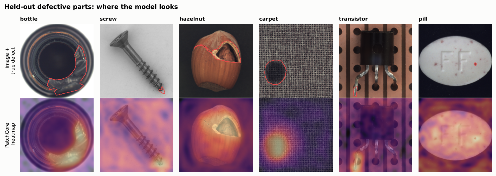
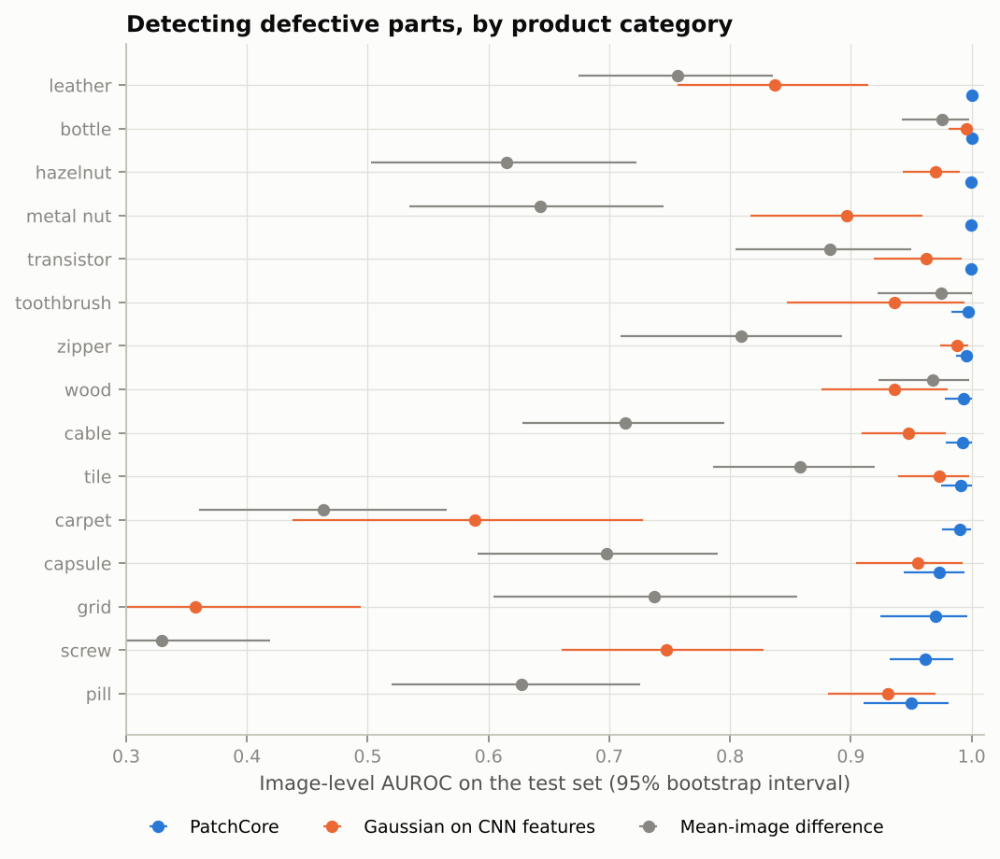
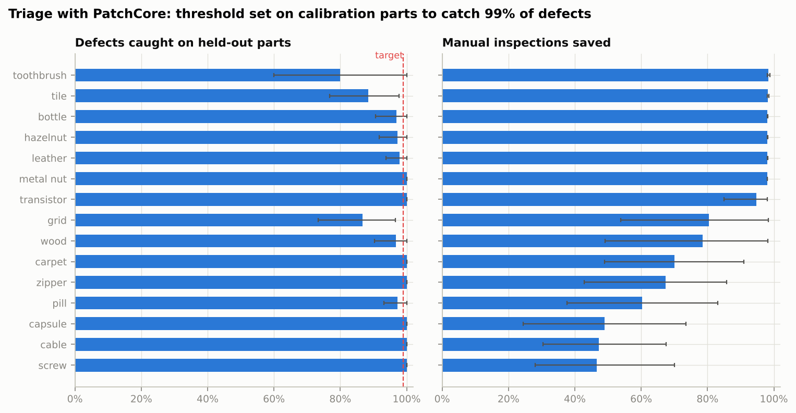
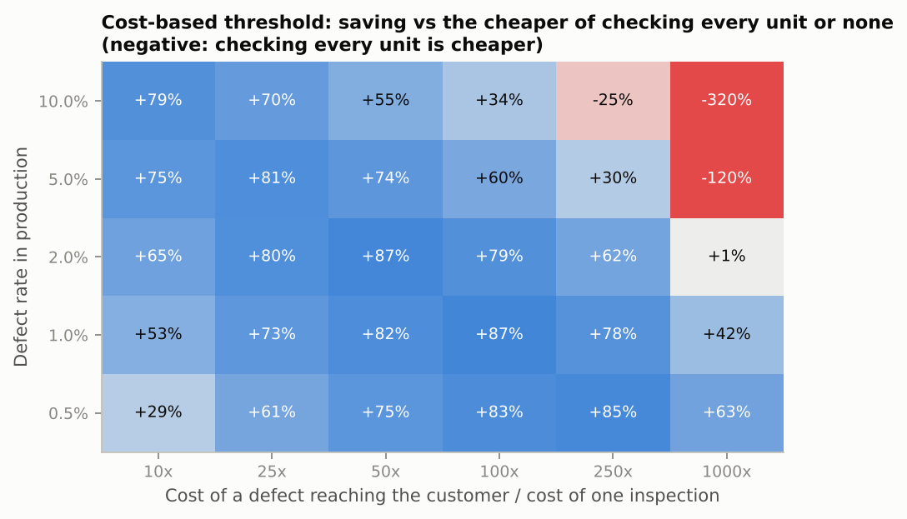

# Visual Defect Detection for Product Inspection

A model that looks at a photo of a product and decides whether a human
inspector needs to check it, with a heatmap showing where the suspected
defect is. It is trained only on photos of good parts, the usual situation
on a real line where defects are rare and varied, and it is served as an HTTP
API in a Docker container.

I used the 15 product categories of MVTec AD (bottles, cables, screws, pills,
fabrics and so on) and evaluated everything on held-out images.

- PatchCore separates defective from good parts with a mean image-level
  AUROC of 0.987 across the 15 categories (95% CI
  0.983–0.992), against 0.868 for a Gaussian model on
  CNN features and 0.737 for comparing pixels with an average
  good image.
- Used to triage parts, it lets 79% of production pass without a
  manual check at a 2% defect rate, while catching 96.1%
  of the defects in held-out images. The target was 99%; why it
  fell short is explained below.
- With $1.00 per manual check and $100 per defect that
  reaches a customer, the cost-based threshold works out at $0.21 per
  unit, against $1.00 for checking everything by hand.
- The service takes 71 ms per image on 4 CPU cores (101 ms at the
  95th percentile).



## Data

[MVTec AD](https://www.mvtec.com/research-teaching/datasets/mvtec-ad)
(Bergmann et al., 2021): 3,629 training photos of good parts and
1,725 test photos (1,258 of them defective, with
pixel masks of the defects) across 15 categories of objects and textures.
`scripts/01_download.py` downloads the official archives from MVTec and checks
each against a recorded SHA-256. The data is licensed CC BY-NC-SA 4.0, for
non-commercial use, which is why this is a research prototype and not a
product.

## Method

**Splits.** For each category, 80% of the good training photos build the
model and 20% are kept back. The test photos are split 50/50 by defect type
into a calibration half and a held-out half. Thresholds are chosen on the
calibration images (the kept-back good photos plus the calibration half) and
judged once on the held-out half. MVTec's test sets have few good photos, so
the kept-back training photos give the calibration step more good examples
to set false-alarm rates on.

**PatchCore** (Roth et al., 2022). A WideResNet-50 pretrained on ImageNet
describes each cell of a 28 x 28 grid over the 224 x 224 image with a
1,536-number feature vector, taken from the network's second and third stages
and averaged over the cell's neighbours. The patches of
the good training photos go into a memory bank, thinned to 1%
by greedy coreset selection so it covers the variety of good patches without
storing all of them. A new photo's patches are compared with the bank: the
distance to the nearest stored patch is that patch's anomaly score, the
largest one is the image score, and the scores upsampled and smoothed are the
heatmap. Nothing is trained by gradient descent, so a new product line needs
only a few hundred good photos and a few minutes on a CPU.

**Baselines.** A single Gaussian fitted to the globally pooled features of
the same network and scored by Mahalanobis distance (Rippel et al., 2020),
and the per-pixel difference from the average good photo, which uses no
learned features at all.

**Uncertainty.** Every AUROC and every held-out rate comes with a 95%
interval from a stratified bootstrap (1,000 resamples). The average over
categories is bootstrapped by averaging the per-category resamples.

## Results

### Detection

| | Mean image AUROC (95% CI) | Categories at 0.99 or above |
|---|---|---|
| PatchCore | 0.987 (0.983–0.992) | 11 of 15 |
| Gaussian on CNN features | 0.868 (0.849–0.887) | 1 of 15 |
| Mean-image difference | 0.737 (0.714–0.759) | 0 of 15 |

PatchCore is ahead of the Gaussian model by 0.119 AUROC
(paired 95% CI 0.101–0.138) and of the pixel baseline by
0.251 (0.229–0.273). It also localises
defects: the heatmaps reach a mean pixel-level AUROC of 0.977
against the masks, compared with 0.734 for the pixel baseline.
The hardest category is pill (AUROC 0.950, CI
0.911–0.981).

| Category | Test images (defective) | PatchCore | Gaussian on CNN features | Mean-image difference | PatchCore pixel AUROC |
|---|---|---|---|---|---|
| bottle | 83 (63) | 1.000 (1.000–1.000) | 0.995 | 0.975 | 0.983 |
| leather | 124 (92) | 1.000 (1.000–1.000) | 0.837 | 0.756 | 0.991 |
| hazelnut | 110 (70) | 1.000 (0.998–1.000) | 0.970 | 0.615 | 0.984 |
| metal nut | 115 (93) | 1.000 (0.997–1.000) | 0.897 | 0.643 | 0.984 |
| transistor | 100 (40) | 0.999 (0.996–1.000) | 0.963 | 0.882 | 0.975 |
| toothbrush | 42 (30) | 0.997 (0.983–1.000) | 0.936 | 0.975 | 0.986 |
| zipper | 151 (119) | 0.996 (0.987–1.000) | 0.988 | 0.809 | 0.982 |
| wood | 79 (60) | 0.993 (0.978–1.000) | 0.936 | 0.968 | 0.938 |
| cable | 150 (92) | 0.993 (0.978–1.000) | 0.948 | 0.713 | 0.984 |
| tile | 117 (84) | 0.991 (0.975–1.000) | 0.973 | 0.858 | 0.954 |
| carpet | 117 (89) | 0.990 (0.976–1.000) | 0.589 | 0.463 | 0.988 |
| capsule | 132 (109) | 0.973 (0.944–0.994) | 0.955 | 0.698 | 0.987 |
| grid | 78 (57) | 0.970 (0.925–0.997) | 0.358 | 0.737 | 0.965 |
| screw | 160 (119) | 0.962 (0.932–0.985) | 0.747 | 0.330 | 0.979 |
| pill | 167 (141) | 0.950 (0.911–0.981) | 0.930 | 0.627 | 0.974 |



### From scores to inspection decisions

On a real line most parts are good, while MVTec's test sets are mostly
defective. So I measure the catch rate on defective photos and the
false-alarm rate on good photos separately, then weight them by an assumed
defect rate of 2%. Flagged parts go to a human inspector;
everything else passes.

**Triage policy.** The threshold is the highest one that still catches
99% of the defects in the calibration images. On the held-out
images:

- defects caught: 96.1% (95% CI 94.2%–97.8%)
- good parts flagged: 19.6% (15.4%–24.3%)
- units sent to an inspector: 21.1%, so 79% of manual
  checks are avoided (74%–83%)
- categories that fell short of the 99% target on held-out
  data: 8 of 15 (worst: toothbrush,
  80% of 15 defects)

The shortfall is mostly a sample-size problem, though categories where the
model is weaker (see the AUROC table) contribute too. Each calibration half
has only 15 to 68 defective photos,
so "catch 99%" in practice means "catch all of them", and the next unseen
defect can easily fall just below that threshold. On a real line I would set
the threshold on many more defect examples, or lower it by a safety margin
and accept a few more checks.

With the Gaussian baseline instead, the same policy catches
95.0% and avoids 50% of checks.

| Category | Held-out images (defective) | Defects caught | Good parts flagged | Inspections saved |
|---|---|---|---|---|
| toothbrush | 21 (15) | 80.0% | 0.0% | 98% |
| grid | 41 (30) | 86.7% | 18.2% | 80% |
| tile | 60 (43) | 88.4% | 0.0% | 98% |
| wood | 41 (31) | 96.8% | 20.0% | 78% |
| bottle | 42 (32) | 96.9% | 0.0% | 98% |
| hazelnut | 56 (36) | 97.2% | 0.0% | 98% |
| pill | 86 (73) | 97.3% | 38.5% | 60% |
| leather | 64 (48) | 97.9% | 0.0% | 98% |
| cable | 76 (47) | 100.0% | 51.7% | 47% |
| capsule | 68 (56) | 100.0% | 50.0% | 49% |
| carpet | 61 (47) | 100.0% | 28.6% | 70% |
| metal nut | 59 (48) | 100.0% | 0.0% | 98% |
| screw | 82 (61) | 100.0% | 52.4% | 47% |
| transistor | 50 (20) | 100.0% | 3.3% | 95% |
| zipper | 77 (61) | 100.0% | 31.2% | 67% |



**Cost-based policy.** If a manual check costs $1.00 and a
defective unit that reaches the customer costs $100, checking every
unit costs $1.00 per unit and checking none costs $2.00. The
threshold that minimises cost on the calibration images gives $0.21
per unit on the held-out images ($0.16–$0.26) while catching
94.7% of defects. That is 79% cheaper than the better
blanket policy, or about $7,934 per 10,000 units.

The heatmap below re-chooses the threshold for defect rates from 0.5% to 10%
and escape costs from 10 to 1,000 times the cost of a check. The model is
cheaper than both blanket policies in 27 of the 30
settings, saving up to 87%. It loses when defects are common and
escapes are very expensive (5% defective with an escape costing 1,000x a check or more; 10% defective with an escape costing 250x a check or more): there, missing even a few
percent of defects costs more than checking every unit, so checking
everything is the right call.



## The service

```bash
make demo                 # downloads the bottle category (156 MB) and fits it
make serve                # http://localhost:8000/docs
curl -F "file=@some_bottle.png" "localhost:8000/inspect/bottle?heatmap=true"
```

`POST /inspect/{category}` returns the anomaly score, the threshold, the
decision (`pass` or `send to inspector`) and, if asked, the heatmap as a
base64 PNG. `?policy=cost_based` switches to the cost-based threshold.
`GET /health` lists the categories with a fitted model. `make docker` builds
and runs the same thing in a container with the backbone weights baked in.

Measured on a 4-core Linux machine with 4 CPU threads, over
the 42 held-out bottle images: 71 ms median model time
(101 ms at the 95th percentile) and 124 ms for the whole request
including the heatmap, about 7.9 images per second.

## Limitations

- MVTec AD photos are taken under controlled lighting with the part centred.
  A real inspection line would need its own photos and a check that the good
  parts used for fitting cover normal variation.
- The defect rate, inspection cost and escape cost are assumptions. The
  sensitivity grid shows how the saving changes with them.
- The held-out halves are small (some categories have under 10 good test
  photos), so the per-category rates have wide intervals.
- One threshold per category. A real deployment would monitor the score
  distribution and refit when the product or camera changes.

## Reproducing

```bash
python -m venv .venv && source .venv/bin/activate
make install
make all      # download (4.9 GB), fit all categories (about 30 min on 4 cores), evaluate, decide, benchmark, README
make test     # tests use a few real images in tests/data and run offline
```

Each step writes `results/*.json` and `figures/`. This README is generated
from those files by `scripts/render_readme.py`, and CI fails if it falls out
of date. Seeds are fixed in `src/defects/config.py` and the dependencies are
pinned.

## Data source and licence

MVTec AD: P. Bergmann, K. Batzner, M. Fauser, D. Sattlegger and C. Steger,
"The MVTec Anomaly Detection Dataset: A Comprehensive Real-World Dataset for
Unsupervised Anomaly Detection", International Journal of Computer Vision,
2021. MVTec Software GmbH, CC BY-NC-SA 4.0. PatchCore: K. Roth et al.,
"Towards Total Recall in Industrial Anomaly Detection", CVPR 2022. Gaussian
baseline: O. Rippel, P. Mertens and D. Merhof, "Modeling the Distribution of
Normal Data in Pre-Trained Deep Features for Anomaly Detection", ICPR 2020.
